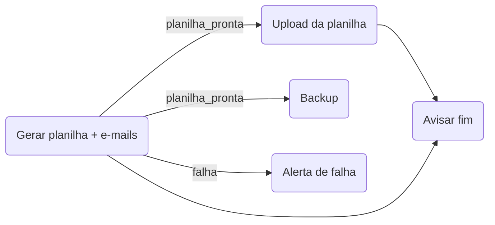

# mermaid-docker-draw

Fork do [mermaid-draw](https://github.com/lucasisabelf/mermaid-draw) em que **cada retângulo é um container Docker** e **cada seta é um gatilho**. Você desenha o fluxo, descreve o container de cada retângulo e aperta ▶. Na tela você acompanha cada container ao vivo: o status pela cor, os logs em tempo real, a "mensagem" percorrendo a seta quando um gatilho dispara e o histórico de execuções.

O que vem do mermaid-draw continua igual: o editor visual, a reatividade fina, o código Mermaid gerado e a API granular.

## O caso que motivou o projeto

Um container gera uma planilha e depois manda um e-mail com ela para cada pessoa. O próximo passo, por exemplo o upload, só precisa da planilha, mas mandar todos os e-mails demora.

O container dispara o próximo passo **no meio do processo**, logo depois que a planilha fica pronta:

```sh
gerar_planilha > "$MDD_SHARED/relatorio.csv"
echo '::mdd emit planilha_pronta {"arquivo":"relatorio.csv"}'   # ← o gatilho dispara aqui
mandar_emails                                                  # e o container continua
```



Esse exemplo está pronto em [`examples/planilha`](examples/planilha):
- `upload` e `backup` sobem **em paralelo** assim que a planilha fica pronta;
- `aviso` espera o upload **e** o fim dos e-mails;
- `alerta` só roda se a planilha falhar.

## Como rodar

### Com Docker (recomendado)

```bash
docker compose up --build                         # abre o exemplo em http://localhost:8080
MDD_PROJECT=meu-fluxo docker compose up --build   # outra pasta de projeto (relativa a esta)
```

O servidor usa o Docker do host pelo socket `/var/run/docker.sock`.

### Desenvolvimento

O servidor está em Go (1.26+) e o editor em TypeScript com Vite (Node 24+).

```bash
npm --prefix web install && npm --prefix web run build
go run ./cmd/mdd --dir examples/planilha --static "$PWD/web/dist"   # http://localhost:8080

# ou, com recarga automática do editor:
go run ./cmd/mdd --dir examples/planilha &
npm --prefix web run dev                         # Vite em :5173, repassando /api para :8080
```

Testes: `go test ./...` e `npm --prefix web test`.

## Projeto

```
meu-fluxo/
  diagram.json        o fluxo: retângulos, setas, posições (o Mermaid é gerado a partir dele)
  nodes/<id>.md       um arquivo por retângulo: descrição + serviço do docker compose
  nodes/<id>/         scripts do retângulo (run.sh, main.py…), editáveis na aba Arquivos
  runs/<runId>/       histórico: run.json (estado de cada retângulo) e <id>.log (saída)
```

### O `.md` de cada retângulo

O arquivo traz texto livre e um bloco ` ```yaml ` com **um serviço do docker compose**, com a mesma sintaxe do `docker-compose.yml`:
- `image`, `command`, `entrypoint`, `environment`, `env_file`, `volumes`, `ports`, `working_dir`, `user`, `extra_hosts`, `network_mode`, `stop_grace_period`…
- Caminhos relativos (`./app`) partem da pasta do projeto.
- `build:` não é suportado: gere a imagem antes e use `image`.

As opções do orquestrador ficam em `x-mdd`:

````md
# Avisar fim

Só roda quando o upload **e** os e-mails terminaram.

```yaml
image: alpine:3.20
command: ["sh", "-c", "echo fluxo concluído"]
x-mdd:
  wait: all      # all (padrão): espera todas as setas que chegam · any: sobe na primeira
  kind: job      # job (padrão): termina sozinho · service: pode rodar para sempre
```
````

No editor, o painel do retângulo tem duas abas:
- **Simples**: um formulário com descrição, imagem, comando, variáveis, volumes, portas, espera e tipo.
- **Código**: o `.md` inteiro.

As alterações são gravadas sozinhas. Criar um retângulo cria um `.md` modelo, e remover o retângulo move o arquivo para `nodes/.removidos/`.

> Como no compose, `${VAR}` no yaml vem do ambiente do servidor. Para uma variável de shell do container, escreva `$$VAR`. As variáveis `MDD_*` (abaixo) ficam como estão e o shell do container as resolve.

## Templates prontos

A paleta tem retângulos que já nascem configurados. Arraste um para o canvas ou clique nele:

| Template | Imagem | Arquivos | Tipo |
|---|---|---|---|
| 🌐 Web | `nginx:1.27-alpine` | `run.sh`, `index.html`, `app.js`, `style.css` | serviço |
| 🐍 Python · serviço | `python:3.12-slim` | `run.sh`, `main.py` (servidor HTTP) | serviço |
| 🐍 Python · job | `python:3.12-slim` | `run.sh`, `main.py` (processa e termina) | job |
| 🐹 Go · serviço | `golang:1.26-alpine` | `run.sh`, `main.go` (servidor HTTP) | serviço |
| 🐹 Go · job | `golang:1.26-alpine` | `run.sh`, `main.go` (processa e termina) | job |

Cada template cria:
- o `nodes/<id>.md` com o yaml pronto;
- a pasta `nodes/<id>/` com os arquivos, montada em `/app`. Ela é editável na aba **Arquivos** do painel, onde também dá para criar e apagar arquivos.

O que já vem configurado:
- **`run.sh`:** provisiona e roda. No Python, instala o `requirements.txt` se ele existir; no Go, compila. Pode ser editado à mão.
- **Porta:** escolhida sozinha, a primeira livre a partir de 8081, e editável no yaml. Enquanto o container roda, aparece um link `↗ :8081` no retângulo e no cabeçalho dos logs.
- **Sinal de pronto:** os serviços imprimem `::mdd emit pronto` quando a porta responde. Uma seta `pronto` liga um serviço ao próximo passo.
- **Site ao vivo:** no Web, editar `index.html`, `app.js` ou `style.css` já aparece no navegador, sem reiniciar.

Por enquanto os arquivos são enviados um a um; no futuro, um `.zip` vai preencher a mesma pasta.

## Gatilhos (o texto da seta)

| Texto da seta | Dispara quando |
|---|---|
| *(vazio)*, `success`, `sucesso` | o container terminou com código 0 |
| `failure`, `falha`, `erro` | terminou com código ≠ 0 ou nem conseguiu iniciar |
| `exit`, `fim` | terminou, com qualquer código |
| `start`, `inicio` | o container acabou de iniciar |
| `log:/regex/` | uma linha da saída casou com a expressão. Serve para processos sem fim que você não controla, como `log:/listening on :\d+/` |
| qualquer outro nome | o container **emitiu** esse evento no meio do processo |

Há duas formas de emitir um evento de dentro do container:

```sh
echo '::mdd emit planilha_pronta'                        # numa linha da saída (qualquer linguagem)
echo '::mdd emit planilha_pronta {"arquivo":"p.csv"}'    # com um payload JSON
wget -qO- --post-data='{"arquivo":"p.csv"}' "$MDD_EMIT_URL/planilha_pronta"   # por HTTP
```

**Regras:**
- **Paralelo.** Todas as setas que esperam o mesmo evento disparam juntas.
- **Junção.** Um retângulo com várias setas chegando espera todas (`wait: all`) ou só a primeira (`wait: any`).
- **Uma vez por execução.** Cada retângulo roda uma vez. Setas que chegam num retângulo que já rodou só piscam.
- **Pulados.** Retângulos que nenhuma seta disparou terminam como *pulados*.
- **Fim.** O fim fica implícito no sentido das setas, então não existe bloco de fim. A execução termina quando nada mais pode acontecer. Os `service` que ainda estiverem rodando são parados nessa hora.

### Variáveis em todo container

| Variável | Conteúdo |
|---|---|
| `MDD_SHARED` | `/mdd/shared`, um volume compartilhado por todos os containers da execução. É por ele que passam a planilha e outros arquivos |
| `MDD_PAYLOAD` | os payloads dos eventos que dispararam este retângulo, `{"planilha_pronta": {...}}` |
| `MDD_EMIT_URL` | o endereço para emitir eventos por HTTP (`POST $MDD_EMIT_URL/<evento>`) |
| `MDD_RUN_ID`, `MDD_NODE_ID` | a execução e o retângulo |

## Na interface

| Ação | Como fazer |
|---|---|
| Marcar o bloco de início | Selecione o retângulo e aperte `I`, ou use o checkbox "Bloco de início". Ele ganha borda dupla e um ▶ |
| Rodar | ▶ no bloco de início (roda a partir dele) ou **▶ Rodar** na barra (a partir de todos os blocos de início) |
| Parar | ■ no bloco de início ou **■ Parar** na barra: todos os containers recebem SIGTERM |
| Reiniciar um retângulo | Selecione e clique em **↻ Reiniciar**. Fora de uma execução, o botão vira **▶ Rodar a partir daqui** |
| Ver os logs | Selecione o retângulo: a saída aparece embaixo, ao vivo. Os eventos `::mdd emit` ficam destacados |
| Histórico | Aba **Histórico**: clicar numa execução antiga recolore o desenho e carrega os logs dela |

**Cores:**
- tracejado cinza: aguardando gatilho;
- azul em movimento: rodando;
- verde: sucesso;
- vermelho: falha;
- âmbar: parado;
- apagado: pulado.

Quando um gatilho dispara, uma mensagem (a bolinha laranja) percorre a seta e o destino dá um pulso. Setas que já dispararam e esperam o destino juntar todas ficam com o tracejado correndo. Com `prefers-reduced-motion`, só a cor muda. Nada disso entra no SVG/PNG exportado. Na pré-visualização do Mermaid, as setas que já dispararam ficam animadas (`e1@{ animate: true }`).

O resto do editor (criar, ligar, editar, responsável, ativo, exportar) funciona como no [mermaid-draw](https://github.com/lucasisabelf/mermaid-draw#como-usar).

## API

São as mesmas rotas do mermaid-draw (`/api/nodes`, `/api/edges`, `/api/diagram`, `/api/diagram.json` e `/api/events`), com o campo `start` nos retângulos. Além delas:

```bash
curl -X POST localhost:8080/api/nodes/planilha/inicio          # marca o bloco de início (nao-inicio desmarca)
curl localhost:8080/api/nodes/planilha/spec                    # o .md do container
curl -X PUT --data-binary @nodes/planilha.md localhost:8080/api/nodes/planilha/spec
curl localhost:8080/api/templates                              # templates da paleta
curl -X POST localhost:8080/api/templates/python-service -d '{"x":200,"y":120}'
curl localhost:8080/api/nodes/py1/files                        # arquivos de nodes/py1/
curl -X PUT --data-binary @main.py localhost:8080/api/nodes/py1/files/main.py
curl -X POST localhost:8080/api/runs -d '{}'                   # roda (ou {"from": "upload"})
curl localhost:8080/api/runs                                   # histórico
curl localhost:8080/api/runs/current                           # execução ativa (ou a última)
curl -X POST localhost:8080/api/runs/<id>/stop
curl -X POST localhost:8080/api/runs/<id>/nodes/upload/restart
curl localhost:8080/api/runs/<id>/nodes/upload/logs
```

`/api/events` também manda os eventos de execução: `run.state`, `run.started`, `run.node`, `run.log`, `run.trigger` e `run.finished`. Eles não têm `rev`, porque rodar não muda o desenho.

## Configuração do servidor

| Flag | Variável | Padrão | |
|---|---|---|---|
| `--addr` | `MDD_ADDR` | `:8080` | endereço HTTP |
| `--dir` | `MDD_DIR` | `.` | pasta do projeto |
| `--static` | `MDD_STATIC` | `web/dist` | editor compilado |
| `--callback-url` | `MDD_CALLBACK_URL` | `host.docker.internal` (no WSL, o IP da distro) | como os containers chegam ao servidor (`$MDD_EMIT_URL`) |
| `--network` | `MDD_NETWORK` | | rede Docker dos containers |
| `--host-dir` | `MDD_HOST_DIR` | | caminho de `--dir` no host, quando o servidor roda em container |
